# RET — Timing Evidence Report (Informe de Evidencia Temporal)

**SoilSense Control · Sistemas en Tiempo Real (4101137) · Universidad Nacional de Colombia, sede Manizales · 2026-2**
**Docente:** Eng. Samuel Cifuentes · **Repositorio del curso:** [saacifuentesmu/4101137-real-time-systems](https://github.com/saacifuentesmu/4101137-real-time-systems)

- **Equipo (pareja):** Camilo Yela · Camilo Obando
- **Placas:**
  - Placa del nodo: **ESP32-S3-DevKitC-1**, ESP32-S3 (QFN56) rev. v0.2, 240 MHz, PSRAM 8 MB, flash 16 MB, MAC `7c:0c:5f:5b:17:5c` (Fig. 1.3).
  - Placa del segundo integrante en el lab 1: ESP32 DevKit V1 (ESP32 rev. v3.1, flash 4 MB) (Fig. 1.4).
  - No se usó la NUCLEO-L476RG: los labs 1 y 2 se hicieron directamente en el ESP32-S3.
- **Instrumento:** Analog Discovery 2 + WaveForms. Se usaron **Logic** (16 DIO, modo Record), **Scope** con *Measurements* y *Persistence*, y **Patterns** (pulsos de flujo a 1 kHz en DIO 7). No se usó un analizador lógico dedicado.
- **Toolchain:** Zephyr v4.4.0-14199-g4c6971ba90a3, WSL2/Ubuntu, VS Code, `west`, `esptool` v5.4.0.
- **Uso de IA (por semana):**

  | Semana | Herramienta | Qué hizo |
  |---|---|---|
  | 1–5 | Claude (Anthropic) | Guía paso a paso de cada lab (comandos, cableado y configuración del AD2) |
  | 1–5 | Claude (Anthropic) | Apoyo en los scripts `ciclo.py`, `analizar_lab02.py` y `analizar_traza.py` |
  | 1–5 | Claude (Anthropic) | Redacción de este RET a partir de nuestras capturas |

  Las mediciones, capturas y montajes son del equipo. La anotación de la Fig. 5.5 se generó con un script sobre nuestra propia captura.

**Documento vivo:** se actualiza cada semana. Se entrega en el workshop (semana 7) y al cierre (semana 14). **Estado: labs 1 a 5 completos.**

**Regla de la casa:** *"show me the trace"*. Toda afirmación de tiempo cita una medición y su instrumento.

**Convenciones**

- **Fig. L.N** = figura N del lab L. Todas las imágenes están en [`img/`](img/), una carpeta por lab. El código **E** (E1, E4b, …) es el de nuestros documentos de evidencia.
- **(est.)** = estimación con un modelo o una cota; todo lo demás está medido.
- **Predicción** = valor esperado, estimado a partir del código y de la charla de cada semana.
- **N/A** = no aplica a nuestro montaje (por ejemplo, filas exclusivas de la L476).
- Decimales con punto, como en WaveForms y en la consola.

**Contenido:** [1. Sistema y tareas](#1-el-sistema-y-su-conjunto-de-tareas) · [2. ADRs](#2-adrs) · [3. Evidencia por semana](#3-evidencia-por-semana) · [4. Planificabilidad](#4-análisis-de-planificabilidad) · [5. Seguridad funcional](#5-seguridad-funcional-proyecto-final) · [6. Componentes de agente](#6-componentes-construidos-por-agente-proyecto-final) · [Anexos](#anexos)

---

## Resultados clave (semanas 1–5)

| Pregunta del lab | Respuesta medida | Evidencia |
|---|---|---|
| ¿El ciclo editar → mensaje dura < 60 s? (L1) | Sí: **41.4 s** pristine y **10.9 s** incremental | Fig. 1.5–1.6 |
| ¿El superloop cumple en reposo? (L2) | Sí en reposo: el peor bloqueo es la telemetría (**64–68 µs**) | Fig. 2.7, 2.11 |
| ¿Y con `calib`? (L2) | No: muestreo detenido **≈ 400 ms** (jitter 412 884 µs), `backlog_peak` 5 → **401** | Fig. 2.12–2.15 |
| ¿Cuánto costó cambiar de silicio? (L3) | **1 archivo de devicetree, 0 líneas de C** | Fig. 3.1 |
| ¿El primer hilo salva al muestreo? (L3) | Sí: con `calib`, periodo **998.8 µs**, `backlog_peak` **0**, `lat_peak_us` **6 µs**. El control sigue roto (**≈ 400 ms**) | Fig. 3.10–3.12 |
| A/B superloop vs kernel (L4) | Jitter en reposo **≈ 70 µs (est.) → 2.2 µs**; con `calib`, **≈ 403 ms → ≤ 9 µs**; control **≈ 403 ms → ≈ 10 ms** | §3, semana 4 |
| ¿Cuánto cuesta el kernel? (L4) | Hueco de cambio de contexto **≤ 8.56 µs**, ≈ 2.5 × 10³ cambios/s → **1.2–2.2 % de CPU** | Fig. 4.6 |
| ¿Qué pila está más justa? (L4) | `ISR0` 464/512 B (**90 %**); de la aplicación, `console_tid` 992/2048 B (48 %) | Anexo C |
| ¿Se ve la preempción en la traza? (L5) | Sí: tick → `console_tid` READY → `sampling_tid` corre en **19.8 µs** → `control_tid` | Fig. 5.5 |
| ¿Cuánto perturba la traza? (L5) | Jitter máximo **2.2 → 18.1 µs (+15.9 µs)**; `C_samp` 0.74 → 10.75 µs | Fig. 5.8–5.9 |

---

## 1. El sistema y su conjunto de tareas

### 1.1 Requisitos (EARS)

Cada requisito es una frase del tipo *cuando/mientras `<condición>`, el sistema deberá `<respuesta>` en `<plazo>`*. Los umbrales de 50 µs, 100 µs y 20 ms los propusimos a partir de la línea base del lab 2.

| ID | Requisito |
|---|---|
| REQ-SAMP-01 | Mientras el nodo esté en operación, el sistema deberá muestrear la presión cada 1 ms con un jitter máximo de 50 µs. |
| REQ-SAMP-02 | Cuando se libere un tick de muestreo, el sistema deberá iniciar la muestra en un máximo de 100 µs. |
| REQ-CTRL-01 | Mientras el sistema esté irrigando, el lazo de control deberá ejecutarse cada 10 ms (plazo = periodo). |
| REQ-CTRL-02 | Cuando la presión supere 3000 mV, el sistema deberá cerrar la válvula en un máximo de 5 ms. |
| REQ-CONS-01 | Cuando el operador envíe un carácter por la consola, el sistema deberá procesarlo (eco) en un máximo de 20 ms (firm). |
| REQ-TELE-01 | Mientras el nodo esté en operación, el sistema deberá emitir una línea de telemetría cada 1 s ± 100 ms (soft). |
| REQ-FLOW-01 | Cuando se acumulen 100 pulsos de flujo, el sistema deberá actualizar el caudal en un máximo de 100 ms. |
| REQ-HMI-01 | Mientras haya una pantalla conectada, el sistema deberá refrescar la HMI cada 500 ms (soft). |

### 1.2 Tareas, tipo y C_i medido

`C_i` = ancho del pulso del GPIO de instrumentación de cada tarea (entrada → salida). En el kernel, la columna sin traza es la que vale para el análisis. La columna con traza solo muestra la perturbación del observador (semana 5).

| Tarea | REQ | Tipo | Periodo T | Plazo D | C_i superloop (S3) | C_i kernel, sin traza | C_i kernel, con traza | Instrumento |
|---|---|---|---|---|---|---|---|---|
| Muestreo (`task_sampling`) | SAMP-01/02, CTRL-02 (detección) | Hard | 1 ms | = T | 0.97 µs | **0.742 µs** prom., 0.810 µs máx. | 10.75 µs prom., 11.47 µs máx. | GPIO4 · AD2 Logic 5 MHz (L2) · AD2 Scope 6.67 MHz (L5) |
| Control PI (`task_control`) | CTRL-01/02 | Hard | 10 ms | = T | 0.56 µs | ≈ 0.4 µs (lectura visual) | ≈ 5.3 µs (est., de la traza) | GPIO5 · AD2 Logic 5 MHz (L2) · Scope Persistence (L4) · traza CTF (L5) |
| Consola (`task_console`) | CONS-01 | Firm | aperiódica (sondeo cada 5 ms en el kernel) | 20 ms | ≈ 54 µs por carácter; `calib`: 398–403 ms | `calib`: 399.3 ms | — | GPIO6 · AD2 Logic 1 MHz (L3, L4) |
| Telemetría (`task_telemetry`) | TELE-01 | Soft | 1 s | ≈ T | 64.9 µs (65.1 prom., 68 máx.) | 63.8 µs prom. (60–80, resolución 10 µs) | — | GPIO7 · AD2 Logic (L2, L3, L4) |
| Lote de flujo (`task_flow_batch`) | FLOW-01 | — | esporádica: cada 100 pulsos (100 ms a 1 kHz) | 100 ms | 2 µs prom., 8 µs máx. | — | — | GPIO15 · AD2 Logic 500 kHz (L2) |
| HMI (`task_display`) | HMI-01 | Soft | 500 ms | ≈ T | sin OLED: la tarea no hace nada | — | — | GPIO17 (línea plana) |

**Criterio de clasificación (lab 1).** **Hard** significa que perder el plazo es una falla física: una muestra tardía corrompe el control y la detección de sobrepresión, y una válvula que actúa tarde revienta mangueras. **Firm** significa que el resultado tardío se descarta sin daño: una respuesta de consola tardía no sirve, pero no rompe nada. **Soft** significa que el resultado tardío aún sirve con menor calidad (telemetría, HMI). El lote de flujo no tiene plazo propio: es un cálculo de apoyo.

### 1.3 Montaje de medición

Usamos el mismo cableado en los labs 2 a 5. Los seis pines de instrumentación son consecutivos en el header J1 del DevKitC.

| AD2 | Pin ESP32-S3 | Señal | Instrumento |
|---|---|---|---|
| DIO 0 | GPIO4 | `instr_samp` | Logic |
| DIO 1 | GPIO5 | `instr_ctrl` | Logic |
| DIO 2 | GPIO6 | `instr_cons` | Logic |
| DIO 3 | GPIO7 | `instr_tele` | Logic |
| DIO 4 | GPIO15 | `instr_flow` | Logic |
| DIO 5 | GPIO17 | `instr_disp` | Logic |
| DIO 7 (`fin` / `pulsos`) | GPIO16 | entrada de pulsos de flujo, 1 kHz | Patterns (salida) |
| 1+ / 1− | GPIO4 / GND | `instr_samp` | Scope CH1 |
| 2+ / 2− | GPIO5 / GND | `instr_ctrl` | Scope CH2 |
| ⏚ | GND | tierra común | — |

**Nota de método: la resolución del Logic.** Los pulsos de `samp` y `ctrl` duran 0.56–0.97 µs. Con el Logic en modo Record a 500 kHz (2 µs) o 1 MHz (1 µs), un pulso solo se registra si un instante de muestreo cae dentro de él. Por eso se pierde una fracción de los pulsos, y las estadísticas de periodo de esos dos canales salen infladas (múltiplos de 1 ms). La pérdida es predecible y cuadra con el ancho medido (0.742 µs):

| Captura | Pulsos `samp` detectados / esperados | Fracción | Ancho / resolución |
|---|---|---|---|
| L2, 500 kHz, 32 s | 12 008 / 32 000 | 37.5 % | 0.742 / 2 = 37.1 % |
| L3, 1 MHz | periodo promedio 1.3444 ms → 1/1.3444 | 74.4 % | 0.742 / 1 = 74.2 % |

Por eso, en esas capturas solo usamos del Logic: los anchos de pulsos largos (telemetría, consola, `calib`), los huecos de cientos de ms y los mínimos de periodo. El **jitter fino** sale del **Scope** (100 MHz y 6.67 MHz, con estadísticas) y de los contadores propios del firmware (`backlog_peak`, `lat_peak_us`). La señal `fin` (500 µs de ancho) sí se detecta completa: 31 999 periodos de 1000.0 µs en 32 s, lo que confirma el diagnóstico.

---

## 2. ADRs

### ADR-001 — Arquitectura del nodo: kernel multihilo (Zephyr) en lugar de superloop

**Contexto.** En el ESP32-S3, el superloop cumple en reposo: su peor bloqueo es la telemetría, de 64–68 µs (Fig. 2.7, 2.11), con jitter estimado de ≈ 70 µs (est.). El comando bloqueante `calib` lo rompe: `cmd_calib()` hace 1000 × `k_busy_wait(400)` (`main.c:407`) dentro del único `while (1)`. Con eso, el muestreo se detiene ≈ 400 ms (jitter 412 884 µs, Fig. 2.15), `backlog_peak` pasa de 5 a 401 (Fig. 2.12) y el control deja de correr ≈ 403 ms (Fig. 3.4). Esto viola REQ-SAMP-01 y REQ-CTRL-01.

**Decisión.** Cada tarea pasa a un hilo con prioridad *rate-monotonic*, y `main` solo inicializa y retorna:

| Hilo | Prioridad |
|---|---|
| muestreo | 2 |
| control | 3 |
| lote de flujo, en workqueue propia | 5 |
| display | 7 |
| telemetría | 8 |
| consola | 9 |

La ISR del tick encola su instante de liberación en un `k_msgq`. El muestreo despierta al control con un `k_sem` cada 10.ª muestra.

**Justificación (tabla A/B, semana 4):**

| Medida | Superloop | Kernel |
|---|---|---|
| Jitter máximo en reposo | ≈ 70 µs (est.) | **2.2 µs** (Scope, 996 adquisiciones) |
| Jitter máximo con `calib` | ≈ 403 ms | **≤ 9 µs** (`lat_peak_us` = 9, `backlog_peak` = 0) |
| Periodo de control con `calib` | ≈ 403 ms | **≈ 10 ms** |

**Costo reconocido:**

- **Cambio de contexto.** El hueco GPIO es de 8.56 µs como máximo (Fig. 4.6). Con ≈ 2.5 × 10³ cambios/s, eso es **1.2–2.2 % de CPU**. El thread analyzer cuenta 3.8 µs de CPU por activación del muestreo, frente a un `C_samp` de 0.74 µs: el resto es kernel.
- **RAM.** Las pilas de los hilos suman 9.7 KB (1536 + 1024 × 2 + 2048 × 3) más `main`.
- **Estado compartido.** Queda estado compartido entre hilos sin proteger; se resuelve en la semana 6.
- **Pilas justas.** La pila de ISR queda al 90 % (ADR-002).

**Estado:** Aceptado (semana 4).

### ADR-002 — Márgenes de pila antes de producción

**Contexto.** El thread analyzer bajo carga (pulsos de flujo, `set 2500`, `calib`, 2090 s de operación) muestra `ISR0` en 464/512 B (90 %, 48 B libres) e `idle` en 208/256 B (81 %, 48 B libres). Los hilos de la aplicación quedan por debajo del 50 %: el más alto es `console_tid`, con 992/2048 B (Anexo C).

**Decisión (propuesta).** Subir `CONFIG_ISR_STACK_SIZE` de 512 a 1024 B y `CONFIG_IDLE_STACK_SIZE` de 256 a 512 B. Reducir `display_tid` de 2048 a 1024 B, porque usa 288 B. Mantener un margen ≥ 50 % en todos los hilos.

**Justificación.** 48 B libres equivalen a una o dos tramas de interrupción anidadas más. La ISR del flujo y la del tick comparten esa pila, y la traza (semana 5) añade trabajo en ISR. El cambio no aumenta la RAM: suma 768 B en ISR e idle y libera 1024 B en display (ahorro neto de 256 B).

**Estado:** Propuesto (a verificar con `threads` en la semana 6).

---

## 3. Evidencia por semana

Cada entrada cita los `REQ` que verifica. La matriz de trazabilidad completa está en la [§3.6](#36-matriz-de-trazabilidad-rtm).

### 3.1 Semana 1 — Bring-up: equipo, placa y toolchain

**Qué se pidió.** Cada integrante compila y flashea desde su portátil. Se mide el ciclo editar → build → flash → mensaje, con `-p` y sin `-p`. Se crea el RET.

| Cantidad | Predicción | Valor medido | Meta |
|---|---|---|---|
| Editar → build pristine (`-p`) → flash → mensaje en consola | 60 s | **41.4 s** (build 36.0 + flash 5.2 + arranque 0.2) | < 60 s ✔ |
| Igual, build incremental (una línea cambiada, sin `-p`) | 15 s | **10.9 s** (build 5.5 + flash 5.2 + arranque 0.2) | — |
| Integrantes con firmware corriendo desde su portátil | 2 | **2 / 2** | todos ✔ |

*Condiciones:* portátil `LAPTOP-713S6F3K` (WSL2). Placa ESP32-S3, flash por `/dev/ttyACM0` a 921 600 baud. Tiempos cronometrados con [`scripts/ciclo.py`](scripts/ciclo.py), que arranca el reloj con Enter, ejecuta `west build` y `west flash`, abre la consola a 115200 8N1 y detiene el reloj al ver el texto.

**Tarea A: entorno y blinky.** `hello_world` corre en `native_sim/native/64` con el mensaje modificado (Fig. 1.1). El blinky corre en el S3 con un LED externo en GPIO21, porque el DevKitC no tiene un LED simple con alias `led0` (Fig. 1.2a/b, consola `LED state: ON/OFF`). El flasheo identifica el chip y la MAC de la placa (Fig. 1.3). El segundo integrante arranca `hello_world` en su ESP32 DevKit V1 (Fig. 1.4).

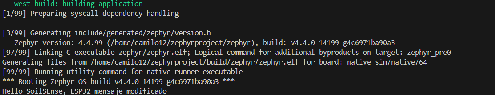
*Fig. 1.1 — `hello_world` en `native_sim/native/64` con el mensaje modificado (E1).*

| | |
|---|---|
| 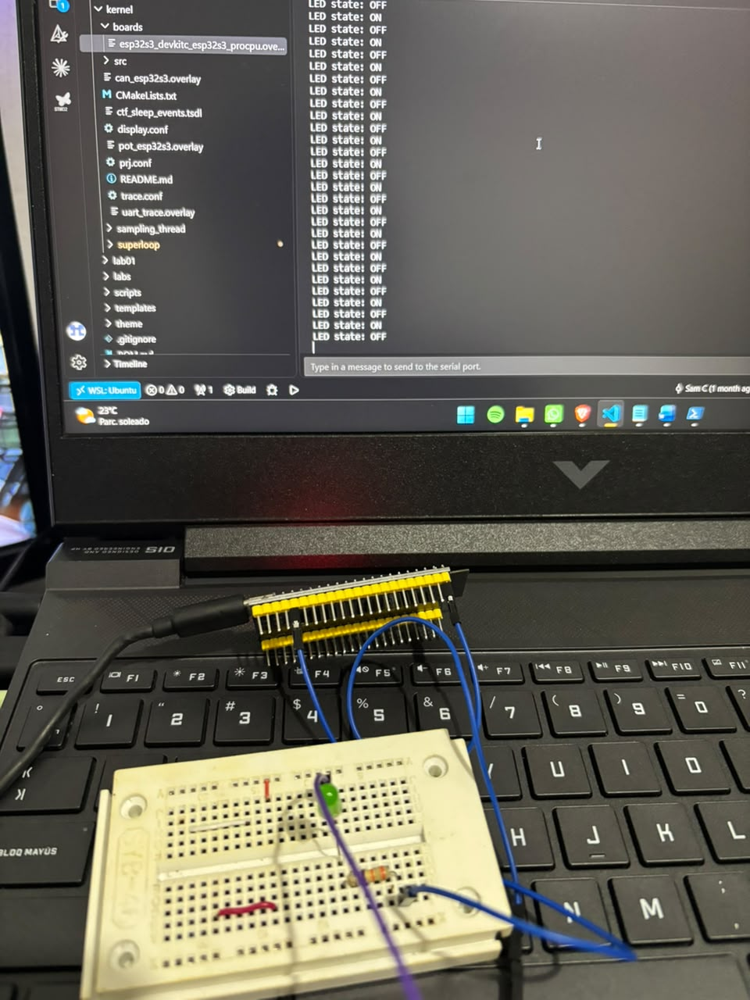 | 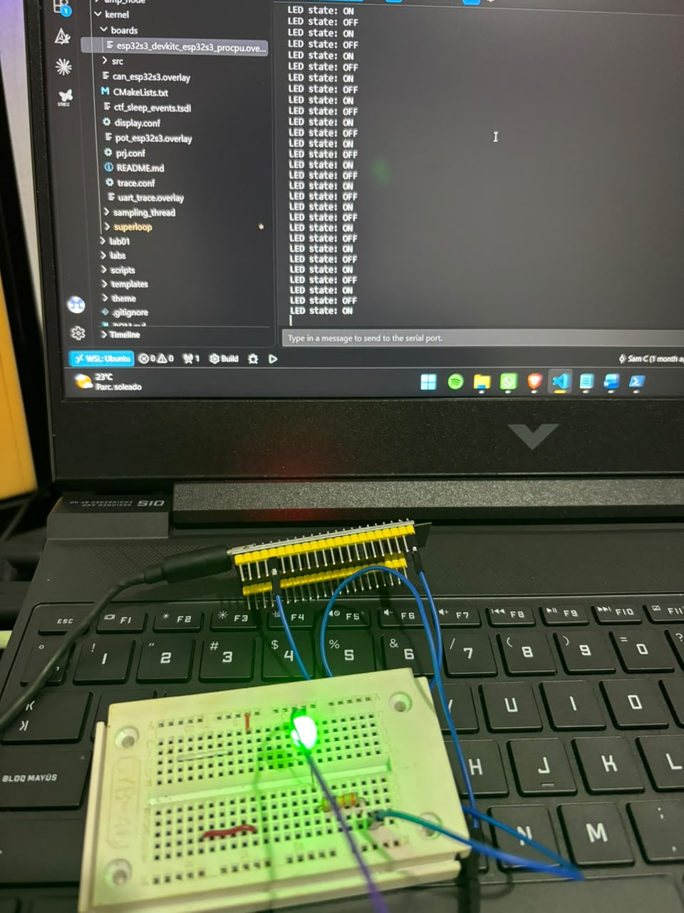 |
| *Fig. 1.2a — Blinky en el S3, LED apagado.* | *Fig. 1.2b — Blinky en el S3, LED encendido.* |

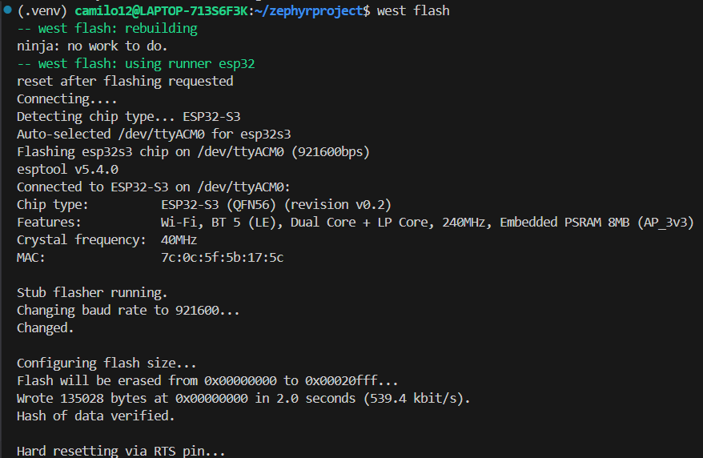
*Fig. 1.3 — `west flash` en el ESP32-S3: chip, 240 MHz, PSRAM 8 MB, MAC `7c:0c:5f:5b:17:5c` (E3).*

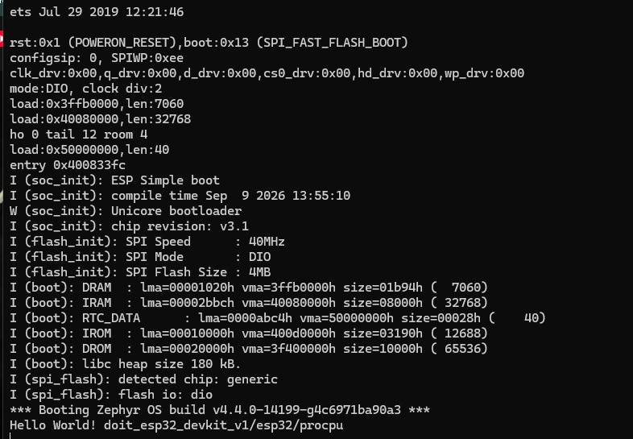
*Fig. 1.4 — Segundo integrante: arranque de `hello_world` en ESP32 DevKit V1 (E4).*

**Tarea B: consola serie y tiempo del ciclo.**

| | |
|---|---|
| 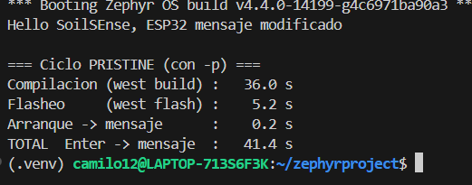 | 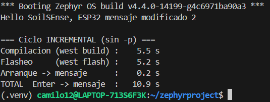 |
| *Fig. 1.5 — Ciclo pristine: 41.4 s (E5).* | *Fig. 1.6 — Ciclo incremental: 10.9 s (E6).* |

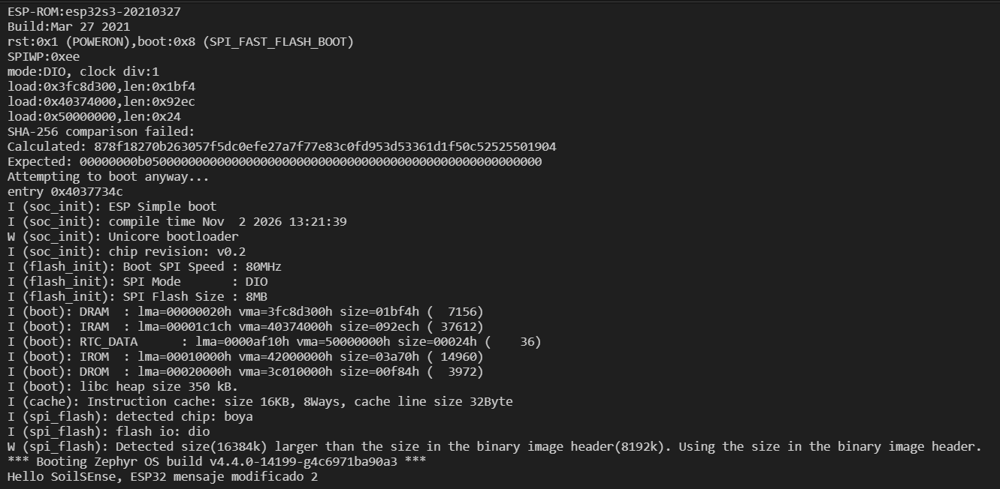
*Fig. 1.7 — Consola del S3 a 115200 8N1 con el mensaje modificado (E7).*

**Lectura.** El ciclo pristine cumple con 18.6 s de margen. El 87 % del tiempo es compilación: el pristine reconstruye kernel y HAL, mientras el incremental recompila `main.c` y enlaza (5.5 s, 6.5× menos). El flasheo es fijo, 5.2 s: `esptool` escribe 135 KB en 2.0 s más conexión y reset. Con esto el equipo puede iterar en ≈ 11 s.

**Tarea C: RET creado.** Este documento, con el encabezado y la §1 (tipos H/F/S justificados en la §1.2).

> **¿Y FreeRTOS?** No tiene equivalente a `west` + devicetree. Cada fabricante trae su SDK (ESP-IDF, STM32Cube) con FreeRTOS adentro. Zephyr se aprende una vez y viaja entre chips. FreeRTOS es más rápido de aprender, pero el entorno cambia con cada fabricante.

---

### 3.2 Semana 2 — Línea base del superloop (ESP32-S3) · verifica REQ-SAMP-01, REQ-CTRL-01, REQ-FLOW-01, REQ-TELE-01

**Tarea A: completar el superloop.** En `firmware/superloop/src/main.c` se completaron las tres piezas.

**TASK 1, el instrumento** (`instr_set`):

```c
	if (p->port) {
		gpio_pin_set_dt(p, v);
	}
```

**TASK 2, el traspaso** (`tick_isr`). La ISR no muestrea: solo cuenta ticks pendientes.

```c
	atomic_val_t backlog = atomic_inc(&ticks_pending) + 1;

	if (backlog > atomic_get(&backlog_peak)) {
		atomic_set(&backlog_peak, backlog);
	}
```

**TASK 3, el lazo** (`main`). Un `while (1)` en orden fijo que drena un tick por vuelta.

```c
	int control_div = 0;

	while (1) {
		task_console();
		task_display();
		task_telemetry();

		if (atomic_get(&ticks_pending) > 0) {
			atomic_dec(&ticks_pending);
			task_sampling();
			if (++control_div >= CONTROL_EVERY) {
				control_div = 0;
				task_control();
			}
		}

		task_flow_batch();
	}
```

Antes de TASK 3, el compilador advierte que `task_console`, `task_display`, `task_telemetry`, `task_sampling`, `task_control` y `task_flow_batch` están *defined but not used*. Esa lista es la "descripción del puesto" del superloop. Con TASK 3, el build para `esp32s3_devkitc/esp32s3/procpu` enlaza limpio (Fig. 2.1). La consola responde `help` y `status`, y la presión se mueve alrededor del setpoint de 1500 mV (Fig. 2.2).

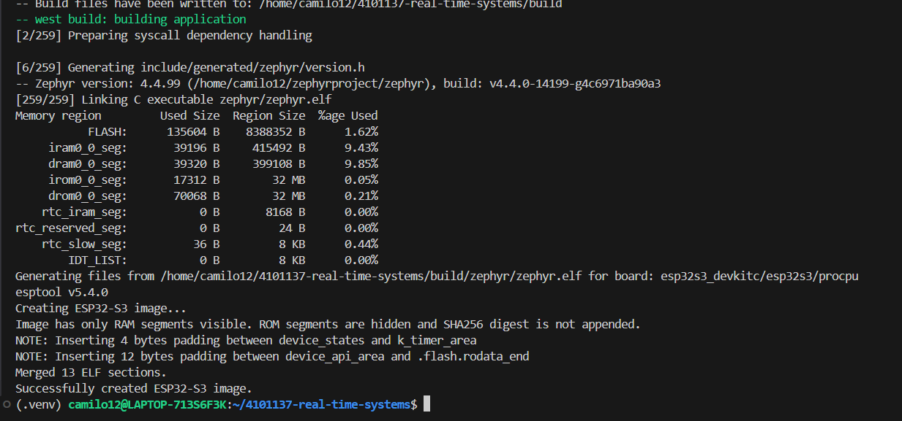
*Fig. 2.1 — Build del superloop para el S3 (E1).*

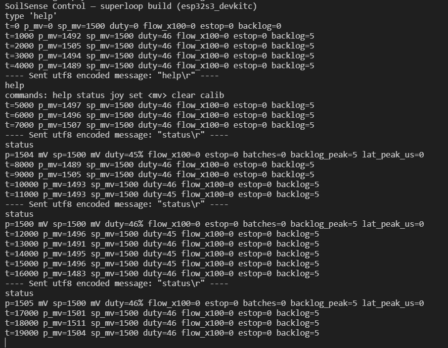
*Fig. 2.2 — `help` y `status` respondiendo; telemetría cada 1 s (E2).*

**Diagrama de flujo (≤ 10 cajas, con los GPIO).** Trabajo por bandera de ISR: `tick_isr` (`ticks_pending++`) y `flow_isr` (`flow_pulses++`). Trabajo sondeado en el lazo: consola (GPIO6), display (GPIO17), telemetría (GPIO7), muestreo (GPIO4), control (GPIO5) y lote de flujo (GPIO15).

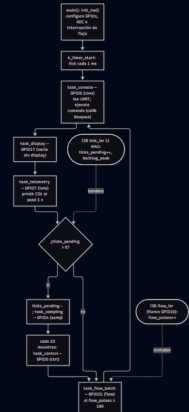

*Fig. 2.3 — Flujo del superloop con los GPIO de instrumentación (E3).*

**Tarea B: la línea base.** Condiciones de la captura:

- AD2 Logic en modo Record a 500 kHz (2 µs). Captura base de **32.00 s** (16 M muestras) y captura de `calib` de **16.00 s**, el 2026-11-02.
- Pulsos de flujo de 1 kHz desde Patterns (DIO 7 → GPIO16).
- Sin pantalla OLED.
- Build `west build -p -b esp32s3_devkitc/esp32s3/procpu firmware/superloop`.
- Análisis con [`scripts/analizar_lab02.py`](scripts/analizar_lab02.py) sobre el CSV exportado (Fig. 2.11 y 2.15).

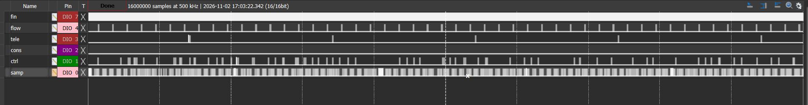
*Fig. 2.4 — Captura completa de 32 s, 6 canales + pulsos de flujo (E4).*

| | |
|---|---|
| 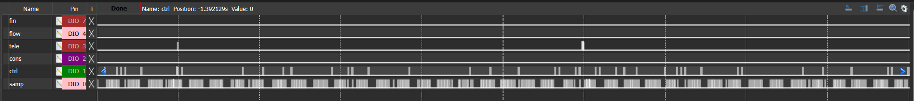 | 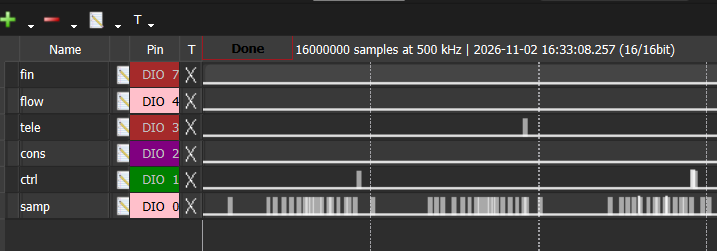 |
| *Fig. 2.5 — Vista ampliada con telemetría y control (E5).* | *Fig. 2.6 — Otra ventana de la captura (E5).* |

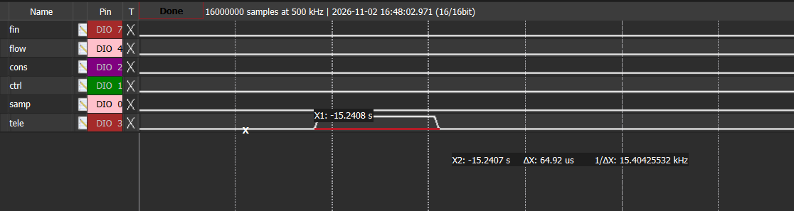
*Fig. 2.7 — `C_i` de la telemetría: 64.92 µs (E5).*

| | |
|---|---|
| 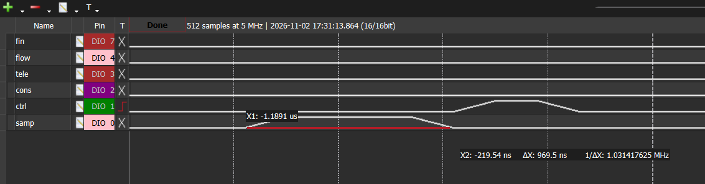 | 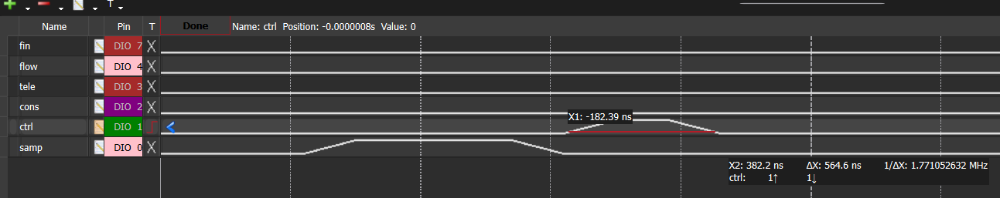 |
| *Fig. 2.8 — Ancho de `samp`: 969.5 ns (Logic 5 MHz, E6).* | *Fig. 2.9 — Ancho de `ctrl`: 564.6 ns (E6).* |

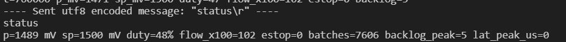
*Fig. 2.10 — `status` en reposo con pulsos de flujo: `batches=7606`, `backlog_peak=5` (E7).*

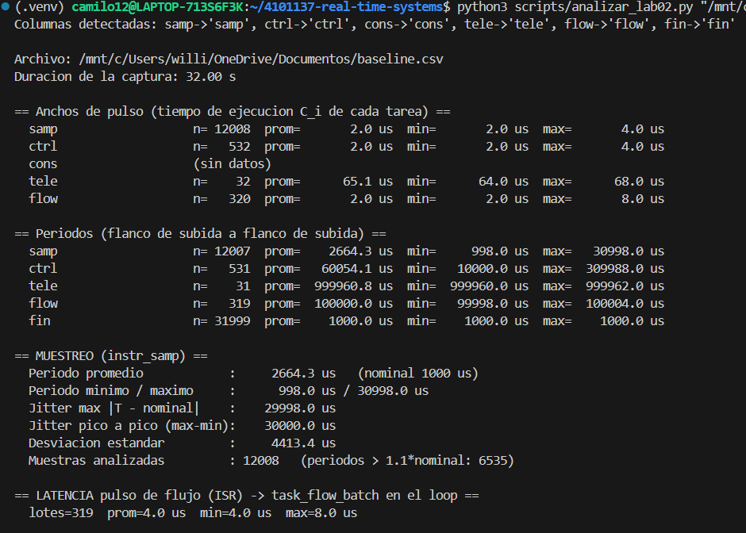
*Fig. 2.11 — Salida de `analizar_lab02.py` sobre la captura base de 32 s (E8).*

**Tarea C: romperlo a propósito.** Se escribió `calib` dos veces mientras se capturaba.

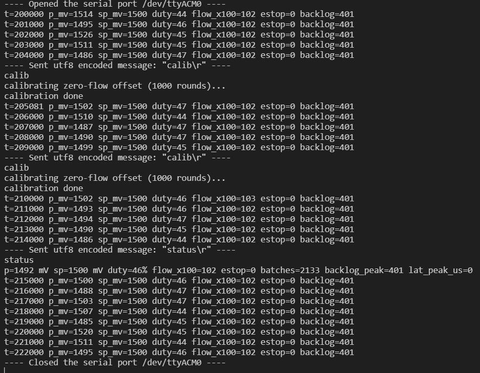
*Fig. 2.12 — Consola con dos `calib` y el `status` posterior: `backlog_peak=401` (E9).*

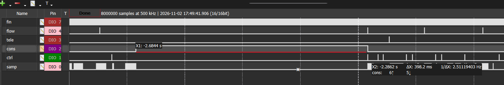
*Fig. 2.13 — `cons` en alto 398.2 ms durante `calib`: en ese intervalo no hay pulsos de `samp` ni de `ctrl` (E10).*

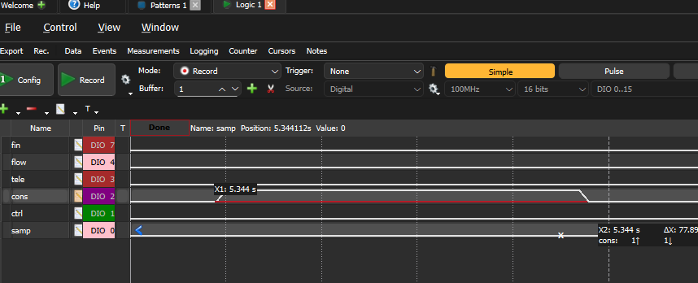
*Fig. 2.14 — Configuración del Logic en modo Record (E10).*

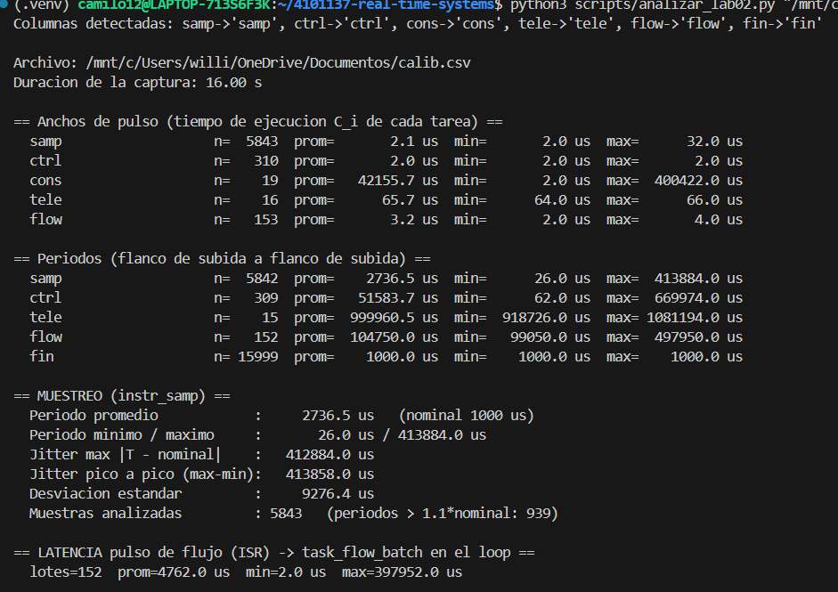
*Fig. 2.15 — `analizar_lab02.py` sobre la captura de `calib` de 16 s (E11).*

**Tabla de la semana 2 (ESP32-S3, superloop):**

| Medida | Predicción | Valor medido | Referencia |
|---|---|---|---|
| Periodo real de muestreo, promedio | 1000 µs | **≈ 1000 µs** (999.96 µs; ver nota 1) | 1000 µs |
| Jitter de muestreo, máximo en ≥ 30 s | 70 µs | **≈ 70 µs (est.)**: cota por la telemetría, `C_tele` 64–68 µs (nota 2) | línea base del curso |
| Latencia ISR del pulso de flujo → servicio en el lazo | 10 µs | **4.0 µs prom., 8.0 µs máx.** (319 lotes, resolución 2 µs) | — |
| Jitter máximo con la caché de flash apagada | N/A | **N/A**: `nocache.conf` solo existe para STM32L4 (`depends on SOC_SERIES_STM32L4X`). El S3 ejecuta desde flash SPI a través de caché siempre. | solo L476 |
| Jitter de muestreo con `calib` activo | 400 000 µs | **412 884 µs** (periodo máximo 413 884 µs) | vs fila 2: × ≈ 6000 |
| `backlog_peak`, reposo → durante `calib` | 1 → 400 | **5 → 401** ticks | — |

1. El script reporta un promedio de 2664.3 µs y un jitter de 29 998 µs en reposo. Ambos valores son un artefacto de la resolución del Logic: detectó el 37.5 % de los pulsos (nota de método, §1.3), y los periodos largos son múltiplos de 1000 µs (30 998 ≈ 31 × 1000). El promedio real se infiere de la telemetría, que usa el mismo reloj del sistema que el `k_timer`: 31 periodos de 999 960.8 µs, es decir, 39 ppm entre el reloj del S3 y el del AD2. Eso da un tick de 999.96 µs en la base de tiempo del AD2. El periodo mínimo medido, 998 µs, está dentro de la resolución de 2 µs.
2. En reposo, la tarea más larga del lazo es `task_telemetry` (64–68 µs). Si un tick llega justo cuando empieza, el muestreo espera eso más la vuelta, ≤ 8 µs (est.). El `backlog_peak = 5` en reposo no ocurre durante la captura: se fija en el arranque. El banner (127 B) llena la FIFO TX de 128 B, la primera línea `t=0` (59 B) debe esperar ≈ 58 caracteres × 86.8 µs ≈ 5.0 ms, y eso acumula 5 ticks. En la consola, `backlog=5` aparece desde `t=1000` y no cambia en 19 s (Fig. 2.2). Queda pendiente repetir la línea base con el Scope (método de la semana 5) para reemplazar la estimación.

**C_i medidos (semana 2):** ver §1.2.

- `samp` 0.97 µs y `ctrl` 0.56 µs, medidos con zoom a 5 MHz.
- `tele` 64.92 µs (cursor), con 65.1 µs de promedio y 68 µs de máximo (script).
- `flow` 2 µs de promedio y 8 µs de máximo.
- `cons` durante `calib`: 398.2 ms (cursor), con 400.4 ms de máximo (script).

**Causa raíz de la degradación.** `calib` ejecuta `cmd_calib()` (`firmware/superloop/src/main.c`, líneas 402–409): 1000 rondas de lectura más `k_busy_wait(400);` (línea **407**), es decir, ≈ 400 ms de espera activa. `cmd_calib()` se llama de forma síncrona desde `console_handle()` (línea 432), que corre dentro de `task_console()` (línea 450). `task_console()` está dentro del único `while (1)` (líneas 499–500). Mientras dura `calib`, el lazo no vuelve a `task_sampling()` ni a `task_control()`. Los ticks no se pierden: se acumulan en `ticks_pending` (401) y al terminar se drenan en ráfaga, así que las muestras salen tarde y apiladas.

**Qué tareas sufren.** Sufren todas las del lazo:

| Tarea | Efecto de `calib` |
|---|---|
| Muestreo | hueco de 413 ms |
| Control | sin ejecución ≈ 400 ms |
| Lote de flujo | latencia máxima de 397 952 µs, contra 8 µs en reposo |
| Telemetría | hasta 81 ms tarde (periodo máximo 1 081 194 µs) |

Las que más importan son las Hard: una tarea Firm bloquea a las Hard porque no hay planificador que la desaloje.

**Lectura en una frase.** En reposo, el superloop en el S3 muestrea a 1 kHz con jitter limitado por la telemetría (≈ 70 µs, est.). Un solo comando bloqueante de la consola lo lleva a 412 884 µs: el superloop cumple solo mientras ninguna tarea tarde. `backlog_peak` cuenta la misma historia en ticks: 401 ticks ≈ 401 ms ≈ el hueco del analizador.

**Tarea D: requisitos EARS.** Ver §1.1. Verificaciones de esta semana:

- La fila 2 verifica **REQ-SAMP-01** en reposo.
- La fila 5 muestra que el superloop **no** cumple REQ-SAMP-01 con `calib`.
- La fila 3 verifica **REQ-FLOW-01** en reposo.

> **¿Y FreeRTOS?** Muchos productos FreeRTOS también empiezan como superloop + ISR, y migran al kernel cuando aparece exactamente lo de la Tarea C: una tarea bloqueando al resto.

---

### 3.3 Semana 3 — Port al S3, comparación de silicios y primer hilo · verifica REQ-SAMP-01/02, REQ-CTRL-01

**Tarea A: el port (devicetree).** El port es un archivo: [`firmware/esp32s3_devkitc_esp32s3_procpu.overlay`](firmware/esp32s3_devkitc_esp32s3_procpu.overlay), con 59 líneas. Su contenido:

- Todos los pines en `&gpio0`: `instr_*` en GPIO4, 5, 6, 7, 15 y 17.
- La válvula como nodo `gpio-leds` en GPIO21, con alias `led0`.
- `flow_pulse` en GPIO16 con pull-down.
- La SSD1306 bajo `&i2c0`, con `status = "okay"`.
- Sin los nodos `&usart1`, `&pwm2` y `&pwm3` del STM32.

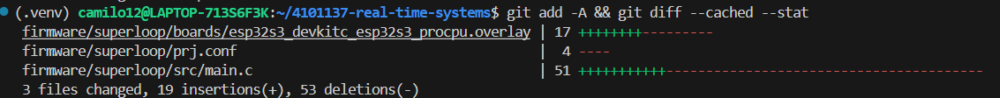
*Fig. 3.1 — `git add -A && git diff --cached --stat` del commit del port (E1).*

**Conteo del port.** El diff-stat muestra 3 archivos, +19 / −53:

| Archivo | Líneas en el diff | ¿Es parte del port? |
|---|---|---|
| `…/esp32s3_devkitc_esp32s3_procpu.overlay` | 17 | Sí: es el ajuste del overlay que creamos en el lab 2 (61 líneas) |
| `main.c` | 51 | No |
| `prj.conf` | 4 | No |

Las líneas de `main.c` y `prj.conf` revierten código del hilo de muestreo que había quedado en el commit del lab 2 (`K_THREAD_DEFINE`, `lat_peak_us`, `CONFIG_MAIN_THREAD_PRIORITY`, *thread analyzer*), verificado con `git show`. En ese lab el `status` imprimía `lat_peak_us=0` (Fig. 2.2). En ese build el lazo seguía siendo un superloop puro: `tick_isr` incrementaba `ticks_pending` y el hilo sobrante quedaba bloqueado para siempre en una cola que nadie llenaba. **Resultado: el port costó 1 archivo de devicetree y 0 líneas de C.** `main.c` es idéntico para la L476 y el S3, porque todos los pines son opcionales vía `GPIO_DT_SPEC_GET_OR`.

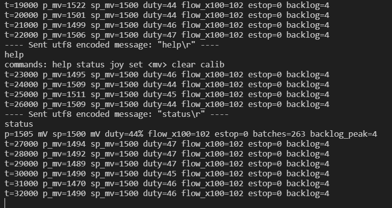
*Fig. 3.2 — Superloop en el S3: `help` y `status` con `backlog_peak=4` (E2).*

**Tarea B: dos silicios, mismo código.** Se usó el protocolo de la semana 2 con el Logic a 1 MHz, una captura de 40 s y pulsos de flujo a 1 kHz.

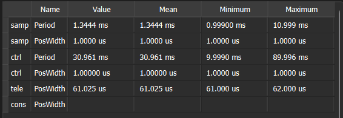
*Fig. 3.3 — Measurements del superloop en reposo (E3). Los periodos de `samp` y `ctrl` están afectados por la resolución (§1.3). `tele` mide 61.0–62.0 µs.*

| | |
|---|---|
| 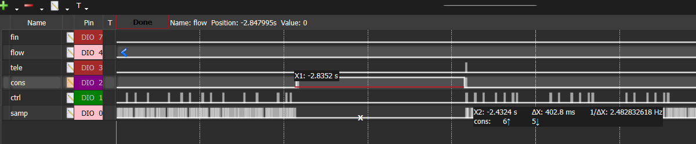 | 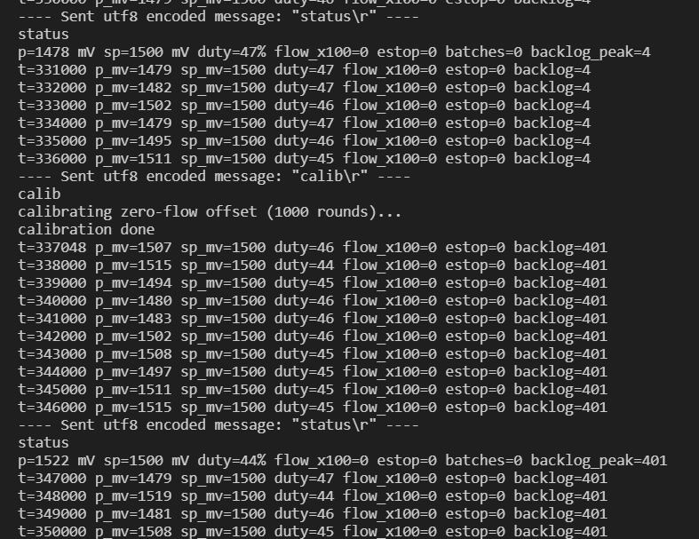 |
| *Fig. 3.4 — `calib`: `cons` en alto 402.8 ms, sin `samp` ni `ctrl` (E4).* | *Fig. 3.5 — `status`: `backlog_peak` 4 → 401 (E4).* |

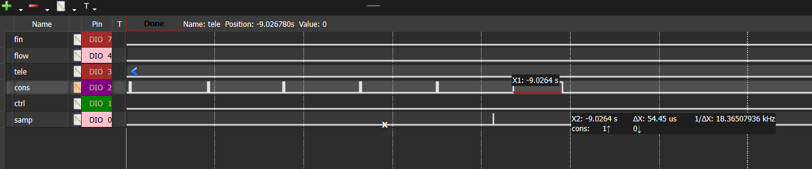
*Fig. 3.6 — Pulso de consola al procesar un carácter: 54.45 µs (E4).*

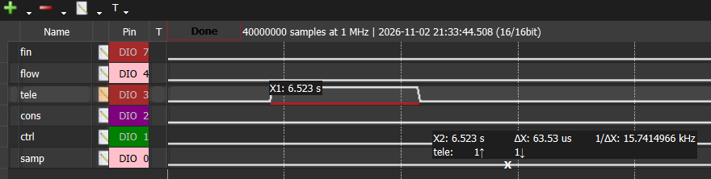
*Fig. 3.7 — Ancho de `tele` en el S3: 63.53 µs (Logic 1 MHz, 40 s; E5).*

**Tarea C: el primer hilo.** Solo se movió el muestreo, con cuatro cambios:

1. **`prj.conf`:** `CONFIG_MAIN_THREAD_PRIORITY=10`, para que un hilo apropiativo quede por encima de `main`.
2. **ISR:** `tick_isr` encola `k_cycle_get_32()` en `K_MSGQ_DEFINE(tick_q, sizeof(uint32_t), 8, 4)` y actualiza `backlog_peak` con `k_msgq_num_used_get`.
3. **Hilo:** `sampling_thread` (prioridad 2, pila de 1536 B) se bloquea en `k_msgq_get`, mide `lat_peak_us`, llama a `task_sampling()` y cada 10.ª muestra hace `atomic_inc(&control_pending)`.
4. **Lazo:** el lazo ejecuta `task_control()` cuando `control_pending > 0`, y `status` imprime `lat_peak_us`.

| | |
|---|---|
| 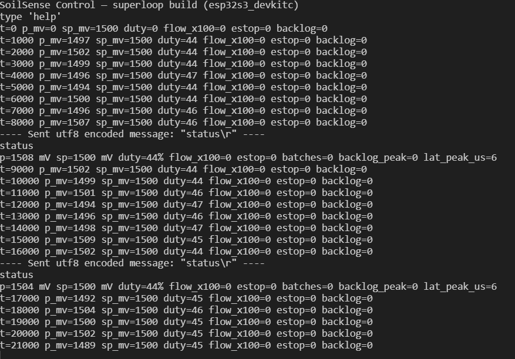 | 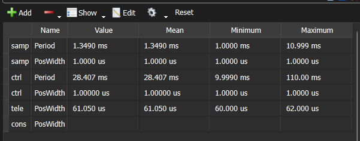 |
| *Fig. 3.8 — Build con hilo: `backlog_peak=0`, `lat_peak_us=6` (E7).* | *Fig. 3.9 — Measurements con hilo en reposo (E8).* |

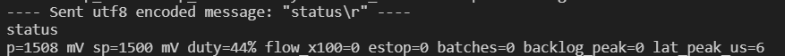
*Fig. 3.9b — `status` durante la captura de la Fig. 3.9: `backlog_peak=0`, `lat_peak_us=6` (E8).*

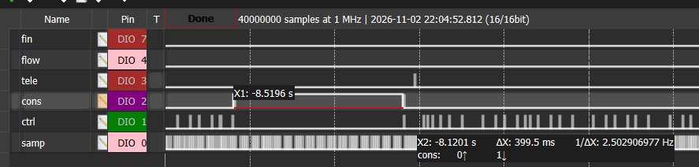
*Fig. 3.10 — **Evidencia principal.** `calib` con hilo: durante los 399.5 ms de `cons`, `samp` sigue a 1 kHz y `ctrl` desaparece (E9).*

| | |
|---|---|
| 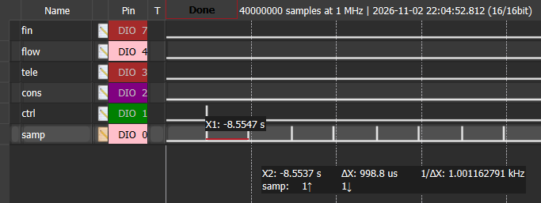 | 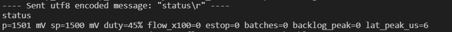 |
| *Fig. 3.11 — Periodo de `samp` dentro de `calib`: 998.8 µs (E9).* | *Fig. 3.12 — `status` tras `calib`: `backlog_peak=0`, `lat_peak_us=6` (E9).* |

**Tabla de la semana 3:**

| Medida | L476RG (sem. 2) | Predicción, S3 superloop | S3 superloop | S3 + hilo de muestreo |
|---|---|---|---|---|
| Jitter máximo de muestreo, ≥ 30 s | N/A (sin L476) | 70 µs | **≈ 62–70 µs (est.)**: cota `C_tele` 61–64 µs | **≤ 6 µs** (`lat_peak_us`) |
| Jitter máximo de muestreo, `calib` activo | N/A | 400 ms | **≈ 402.8 ms** (sin `samp` durante `cons`) | **≈ 1.2 µs** medido (998.8 µs); ≤ 6 µs (`lat_peak_us`) |
| `backlog_peak`, `calib` activo | N/A | 400 ticks | **401 ticks** | **0 ticks** |
| `lat_peak_us` (tick → inicio del hilo, cuenta del firmware) | — | — | — | **6 µs** |
| Periodo máximo de control (`instr_ctrl`), `calib` activo | — | 400 ms | **≈ 403 ms** | **≈ 400 ms** (sin `ctrl` durante 399.5 ms) |

Predicciones para la columna del hilo: jitter 10 µs, `calib` 10 µs, `backlog_peak` 1, `lat_peak_us` 10 µs y control 400 ms. El control lo predijimos roto porque sigue en el lazo.

**¿Qué diferencia de hardware explica el máximo en reposo?** La comparación es por lectura de código, porque no tenemos captura de la L476. El factor es cómo cada driver UART envía un carácter.

`uart_stm32_poll_out_visitor` (`drivers/serial/uart_stm32.c:793`, salida E6) hace espera activa a la bandera **TXE en cada carácter**, porque el USART del L4 tiene un registro de datos de 1 byte:

```c
while (1) {
	if (ll_usart_is_active_txe(usart)) {
		key = irq_lock();
		if (ll_usart_is_active_txe(usart)) {
			break;
		}
		irq_unlock(key);
	}
}
```

`uart_esp32_poll_out` (`drivers/serial/uart_esp32.c`) solo espera si la **FIFO TX de 128 B** está llena:

```c
/* Wait for space in FIFO */
while (uart_hal_get_txfifo_len(&data->hal) == 0) {
	; /* Wait */
}
```

Nuestra línea de telemetría tiene 69 caracteres. A 115200 8N1, cada carácter tarda 86.8 µs. En la L476, la telemetría ocuparía la CPU ≈ 69 × 86.8 µs ≈ **6.0 ms (est.)**, y el muestreo esperaría detrás. En el S3, la línea entera cabe en la FIFO y `instr_tele` dura **61–64 µs** (Fig. 3.7): ≈ 94× menos. Por eso el jitter en reposo del S3 es mucho menor con el mismo código.

**¿Dónde aparecen el reloj y la caché, si no en el máximo?**

- **Reloj.** Los 240 MHz, frente a 80 MHz, se ven en los `C_i`: `samp` dura 0.74–0.97 µs y `ctrl` 0.56 µs. También se ven en el promedio, no en el máximo, que lo dominan los bloqueos de la arquitectura (telemetría, `calib`).
- **Caché.** La caché de la flash SPI externa se ve en la dispersión de esos anchos: el ancho de `samp` sin traza varía de 0.726 a 0.810 µs (Fig. 5.9). Esa dispersión de 0.08 µs viene de aciertos y fallos de caché, y por eso es pequeña frente al bloqueo de la telemetría.

**¿`calib` sigue arruinando el muestreo? No.** `sampling_thread` tiene prioridad 2 y `main` tiene prioridad 10. `main` corre el lazo, la consola y el `k_busy_wait(400)` de `cmd_calib`. En cada tick, `k_msgq_put` pone listo al hilo y el kernel desaloja a `main` aunque esté en plena espera activa. El periodo sigue en 998.8 µs, `backlog_peak = 0` y `lat_peak_us = 6 µs` (Fig. 3.10–3.12).

**¿Y el control? Sí, sigue roto.** El hilo solo incrementa `control_pending`. Quien ejecuta `task_control()` sigue siendo el lazo de `main`, atrapado en `calib`. No aparece ningún pulso de `ctrl` durante 399.5 ms, frente a 10 ms nominales: se viola REQ-CTRL-01. Por eso la semana 4 mueve el control a su propio hilo.

**Estado compartido entre hilos:**

| Variable | Escribe | Lee |
|---|---|---|
| `pressure_mv` | `sampling_thread` (`task_sampling`) | `main`: control, telemetría, `status` |
| `estop` | `sampling_thread` (sobrepresión y joystick) y `main` (comando `clear`) | `main` (`task_control`) |
| `setpoint_mv` | `main` (comando `set`) y `sampling_thread` (joystick, en `joystick_update`) | `main` (control, telemetría) |

**¿Por qué funciona hoy?** Son `int` y `bool` alineados de 32 bits, y en el Xtensa LX7 una carga o un almacenamiento de una palabra es atómico, así que nadie lee un valor a medias. Lo que queda sin proteger son las secuencias leer-modificar-escribir: `setpoint_mv ± 10` contra `set`, o `estop` puesto y borrado por dos hilos. Esas secuencias pueden perder una actualización. Se resuelve en la semana 6.

**Lectura.** Mismo código en dos chips: el máximo en reposo lo pone el driver UART, no el reloj. El primer hilo aísla el muestreo de `calib`, pero cualquier tarea Hard que siga en el lazo hereda el bloqueo.

> **¿Y FreeRTOS?** La Tarea C sería `xTaskCreate(sample_task, "sample", stack, NULL, prio, NULL)`, con la ISR usando `xQueueSendFromISR` y la tarea bloqueada en `xQueueReceive`. En FreeRTOS, mayor número = mayor prioridad. Lo que FreeRTOS no tiene es la Tarea A: sin devicetree, pasar de STM32 a ESP32 es cambiar de SDK, no escribir un overlay.

---

### 3.4 Semana 4 — Migración completa y A/B · verifica REQ-SAMP-01/02, REQ-CTRL-01, REQ-FLOW-01, REQ-TELE-01

**Tarea A: completar la migración.** El plan sigue el orden *rate-monotonic*:

| Hilo | Ejecuta | Lo despierta | Prioridad | Pila |
|---|---|---|---|---|
| `sampling_tid` | `task_sampling` | `tick_q` (`k_msgq`, desde la ISR) | 2 | 1536 B |
| `control_tid` | `task_control` | `k_sem`, que el muestreo da cada 10.ª muestra | 3 | 1024 B |
| `flow_wq` (workqueue propia) | `task_flow_batch` | ISR de flujo al llegar a 100 pulsos (`k_work_submit_to_queue`) | 5 | 1024 B |
| `display_tid` | `task_display` | `k_msleep(50)` | 7 | 2048 B |
| `telemetry_tid` | `task_telemetry` | `k_sleep(K_TIMEOUT_ABS_MS(next))`, `next += 1000` | 8 | 2048 B |
| `console_tid` | `task_console` | `k_msleep(5)` entre sondeos | 9 | 2048 B |

Tres reglas guiaron el diseño:

1. **`main` en prioridad 0.** Se borró `CONFIG_MAIN_THREAD_PRIORITY=10`. Con prioridad 0, `main` supera a todos los hilos e `init_hw()` termina antes de que alguno toque un pin.
2. **Workqueue propia, no la del sistema.** La del sistema corre a −1, que es cooperativa: el muestreo no podría desalojar un lote de flujo.
3. **Todo hilo se bloquea.** Un hilo que sondea sin dormir se come la CPU de todos los que están por debajo. La FIFO RX de 128 B aguanta ≈ 11 ms de tecleo a 115200, así que dormir 5 ms no pierde caracteres.

Se mantuvieron los mismos 6 GPIO de instrumentación, por simetría con el A/B.

**Nodo funcionando (E1, consola):**

```text
SoilSense Control — kernel build (esp32s3_devkitc)
commands: help status joy set <mv> clear calib threads
t=1000 p_mv=1502 sp_mv=1500 duty=46 ... backlog=0
status → p=1502 mV sp=1500 mV duty=47% ... backlog_peak=0 lat_peak_us=6
set 2000 → t=19000 p_mv=2002 sp_mv=2000 duty=62 · status → p=2000 mV ... lat_peak_us=6
set 1500 → t=27000 p_mv=1499 sp_mv=1500 duty=44
```

La telemetría llega exactamente cada 1000 ms y la presión sigue al setpoint en menos de 1 s. La transcripción completa de E1 está en el [Anexo B](#anexo-b--transcripción-de-consola-semana-4-e1).

**Tarea B: el A/B.** Se usó el mismo protocolo: Logic a 1 MHz durante 40 s y pulsos de flujo a 1 kHz, con y sin `calib`, más los contadores del firmware.

| | |
|---|---|
| 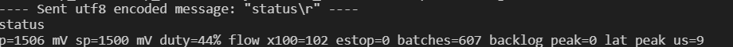 | 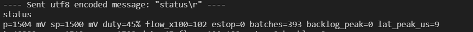 |
| *Fig. 4.1 — `status` en reposo con flujo: `backlog_peak=0`, `lat_peak_us=9` (E2).* | *Fig. 4.2 — `status` tras `calib`: `backlog_peak=0`, `lat_peak_us=9` (E3).* |

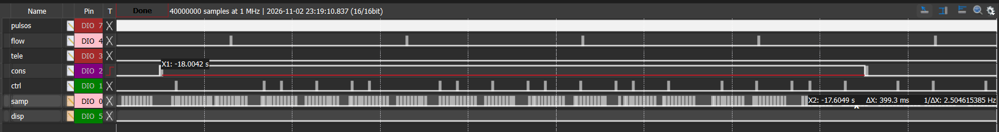
*Fig. 4.3 — **`calib` en el kernel.** Durante los 399.3 ms de `cons`, `samp`, `ctrl` y `flow` siguen ejecutándose (E4).*

| | |
|---|---|
| 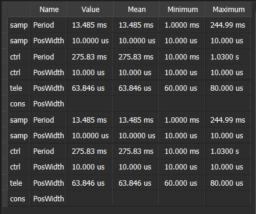 | 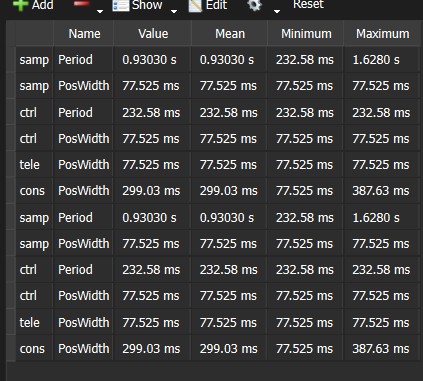 |
| *Fig. 4.4 — Measurements en reposo (E2), no válidas para jitter.* | *Fig. 4.5 — Measurements con `calib` (E3), no válidas.* |

Las dos capturas de *Measurements* de esta semana no sirven para jitter. En la Fig. 4.4, el Logic quedó a 100 kHz: todos los anchos valen 10.000 µs (una muestra) y se detecta el 7.4 % de los pulsos de `samp` (1/13.485 ms), justo lo que predice la nota de método: 0.742 µs / 10 µs = 7.4 %. En la Fig. 4.5, todos los canales muestran 77.525 ms, que es una medición sobre una vista diezmada. Las conservamos como evidencia del error. Los números del A/B salen del Scope (Fig. 4.6 y Fig. 5.9, mismo build sin traza), de los contadores del firmware y de la Fig. 4.3.

**Tabla A/B (ESP32-S3):**

| Medida (S3) | Superloop (sem. 3) | Predicción, kernel | Kernel (hoy) |
|---|---|---|---|
| Jitter máximo de muestreo | ≈ 62–70 µs (est.) | 10 µs | **2.22 µs**: periodo 997.78–1002.0 µs, 996 adquisiciones (Scope, Fig. 5.9) |
| Jitter máximo de muestreo con `calib` | ≈ 402.8 ms | 10 µs | **≤ 9 µs**: `lat_peak_us=9`, `backlog_peak=0` (Fig. 4.2); muestreo continuo durante `calib` (Fig. 4.3) |
| Periodo máximo de control con `calib` | ≈ 403 ms | 10 ms | **≈ 10 ms** (nota 1) |
| Latencia ISR → hilo (`lat_peak_us`) | — | 10 µs | **9 µs** |
| Hueco visible de cambio de contexto (Tarea C) | — | 5 µs | **8.56 µs máximo**, la mayoría 6–7 µs (Fig. 4.6) |
| High-water mark de la pila de `control_tid` | — | 300 B | **288 B / 1024 B asignados (28 %)** |

1. El periodo de control con `calib` se apoya en dos evidencias. La Fig. 4.3 muestra pulsos de `ctrl` regulares durante `calib`. La traza del lab 5 lo confirma numéricamente: en los 1134 décimos ticks, `control_tid` entra entre 10.89 y 11.85 µs después de que `sampling_tid` se bloquea, incluidos los ticks dentro de `calib`. No capturamos su máximo con el Scope.

**Tarea C: el costo (cambio de contexto).** Se usó el Scope a 100 MHz con trigger en el flanco de subida de CH2 (`ctrl`) y *Persistence* durante 1121 adquisiciones. El flanco de bajada de CH1 (`samp`) forma una banda a la izquierda del trigger. El cursor en su borde izquierdo da el hueco máximo: **ΔX = 8.555 µs**.

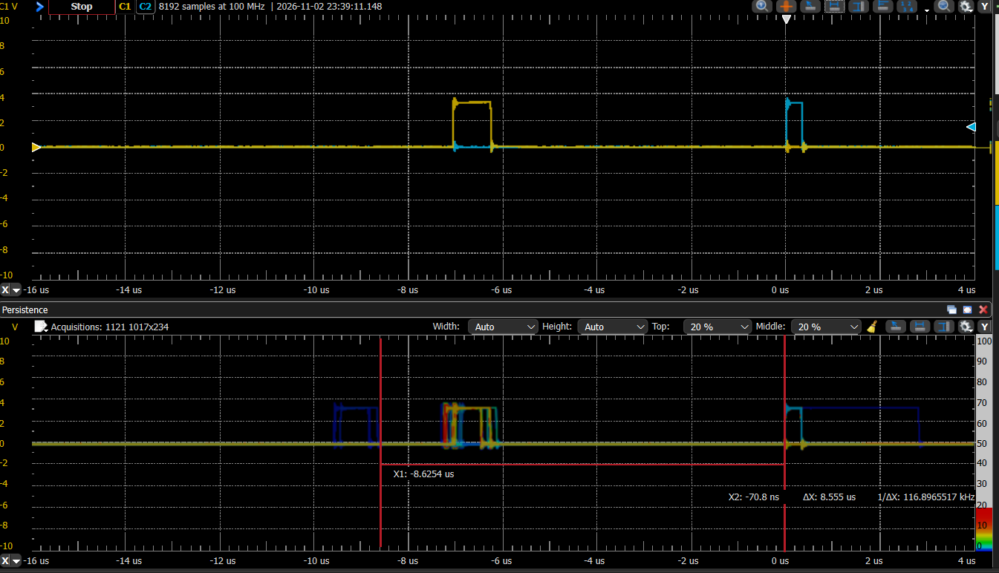
*Fig. 4.6 — Hueco `samp` baja → `ctrl` sube en el 10.º tick, con persistencia: máximo 8.555 µs (E5).*

**Overhead por segundo, con la carga actual (pulsos de flujo a 1 kHz):**

| Fuente | Activaciones/s | Cambios de contexto/s |
|---|---|---|
| Muestreo: idle → sampling → idle | 1000 | 2000 |
| Control: el 10.º tick añade sampling → control | 100 | +100 |
| Consola: idle → console → idle cada 5 ms | 200 | 400 |
| Display, cada 50 ms | 20 | 40 |
| Lote de flujo, 1 kHz / 100 | 10 | 20 |
| Telemetría, cada 1 s | 1 | 2 |
| **Total** | | **≈ 2562** |

```latex
\text{overhead} \approx N_{sw}\, t_{gap} = 2562\ \text{s}^{-1} \times 8.56\ \mu\text{s} \approx 21.9\ \text{ms/s} = 2.2\ \%\ \text{CPU}
```

Esta es una cota superior, porque el hueco GPIO incluye las llamadas de kernel alrededor del cambio. Con el cambio puro que mide la traza (4.85 µs, mediana, semana 5), el overhead es ≈ 12.4 ms/s = **1.2 %**. La traza cuenta 2464 `switched_out`/s en la captura de `calib`, lo que confirma el orden de magnitud. El thread analyzer da un tercer control: el muestreo consume 0.379 % de la CPU, es decir, 3.8 µs por activación, frente a un `C_samp` de 0.74 µs. Los ≈ 3 µs restantes son despertar y cambiar de hilo.

**Tarea D: high-water marks de pila.** Se activaron `CONFIG_THREAD_NAME`, `CONFIG_THREAD_ANALYZER` y `CONFIG_THREAD_ANALYZER_USE_PRINTK`, y se añadió el comando `threads`, que llama a `thread_analyzer_print(0)`. Se ejecutó bajo carga: flujo a 1 kHz, `calib`, `set 2500` y `set 1500`, con 2090 s de operación. La salida completa está en el [Anexo C](#anexo-c--thread-analyzer-semana-4-e6).

| Hilo | Usado / asignado | Uso | Libre | CPU (ciclos acumulados) |
|---|---|---|---|---|
| `ISR0` | 464 / 512 B | **90 %** | 48 B | — |
| `idle` | 208 / 256 B | **81 %** | 48 B | 99.11 % |
| `sysworkq` | 304 / 512 B | 59 % | 208 B | 0.00 % |
| `console_tid` | 992 / 2048 B | 48 % | 1056 B | 0.447 % |
| `telemetry_tid` | 768 / 2048 B | 37 % | 1280 B | 0.007 % |
| `flow_wq` | 304 / 1024 B | 29 % | 720 B | 0.003 % |
| `control_tid` | 288 / 1024 B | 28 % | 736 B | 0.047 % |
| `sampling_tid` | 304 / 1536 B | 19 % | 1232 B | 0.379 % |
| `display_tid` | 288 / 2048 B | 14 % | 1760 B | 0.006 % |

La columna de CPU se calculó con los ciclos que imprime el analizador. Suman 4.975 × 10¹¹ ciclos = 2072.8 s a 240 MHz, lo que coincide con el uptime de `t=2090000` ms.

**El más cercano a su límite es `ISR0`: 464/512 B (90 %, 48 B libres).** De los hilos de la aplicación, el más alto es `console_tid` (48 %), porque `printk` con formato corre en su pila. La propuesta está en el ADR-002.

**Lectura.** Con `calib`, el control pasa de ≈ 403 ms a ≈ 10 ms y el jitter de muestreo de ≈ 403 ms a ≤ 9 µs, porque `calib` ahora corre en `console_tid` (prioridad 9) y tanto el muestreo (2) como el control (3) la desalojan. El precio es ≈ 1–2 % de CPU en cambios de contexto y ≈ 10 KB de pilas.

> **¿Y FreeRTOS?** El mapeo es 1:1:
>
> | Zephyr | FreeRTOS |
> |---|---|
> | `k_msgq` | `xQueue` |
> | `k_sem` | `xSemaphoreGiveFromISR` / `xSemaphoreTake` |
> | `k_work` | tarea *daemon* de timers o una tarea dedicada |
> | high-water mark de pila | `uxTaskGetStackHighWaterMark()` |
>
> FreeRTOS arranca con menos servicios (menor huella). Zephyr trae consola, log y shell listos.

---

### 3.5 Semana 5 — Tracing: ver lo que el analizador no ve · verifica REQ-SAMP-02

**Tarea A: activar el tracing.** Se agregaron dos archivos de build, sin cambios en C:

- `trace.conf`: CTF por UART, búfer de 32 KB y `THREAD_WAIT_THRESHOLD=1`.
- `uart_trace.overlay`: la traza sale por el jack UART a 4 Mbaud y la consola pasa al jack USB (USB-Serial-JTAG).

La captura se hizo con `labs/sops/trace_capture.py` y la metadata con el `ctf_sleep_events.tsdl` del curso.

| | |
|---|---|
| 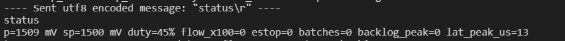 | 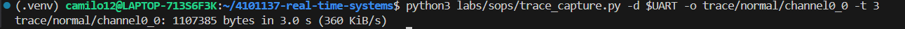 |
| *Fig. 5.1 — `status` respondiendo por el jack USB en el build trazado (`lat_peak_us=13`; E1).* | *Fig. 5.2 — Captura en operación normal: 1 107 385 B en 3.0 s (360 KiB/s).* |

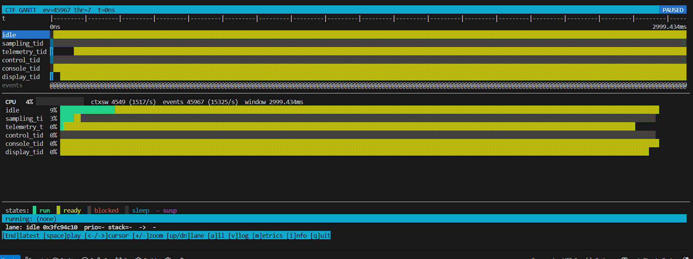
*Fig. 5.3 — Primera traza en `trace_viewer.py` con los hilos nombrados (E2). Ventana de 2999.4 ms: 45 967 eventos (15 325/s) y 4549 `switched_in` (1517/s).*

**Tarea B: la historia de una preempción.** Se tomó una captura con `calib` de 17.4 s (6 276 750 B, 352 KiB/s), analizada con `labs/sops/analizar_traza.py`:

- 174 166 eventos válidos en 11 762.4 ms.
- 26 resincronizaciones por bytes perdidos en el enlace, con 1722 B descartados.
- 11 huecos de más de 2 ms con el búfer lleno.

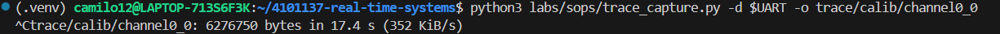
*Fig. 5.4 — Captura de la traza con `calib`: 6 276 750 B en 17.4 s (352 KiB/s).*

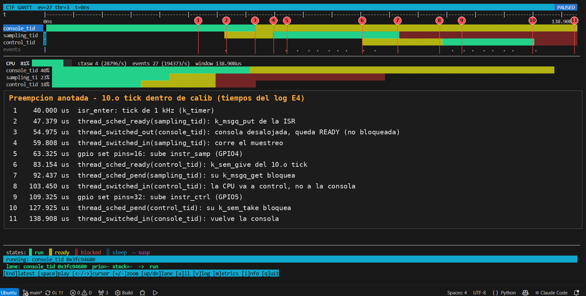
*Fig. 5.5 — **Traza anotada.** Un 10.º tick dentro de `calib`, con la cadena completa numerada (E3, anotación sobre nuestra captura).* La captura original sin anotar está en [`img/lab5/e03_gantt_preempcion.png`](img/lab5/e03_gantt_preempcion.png).

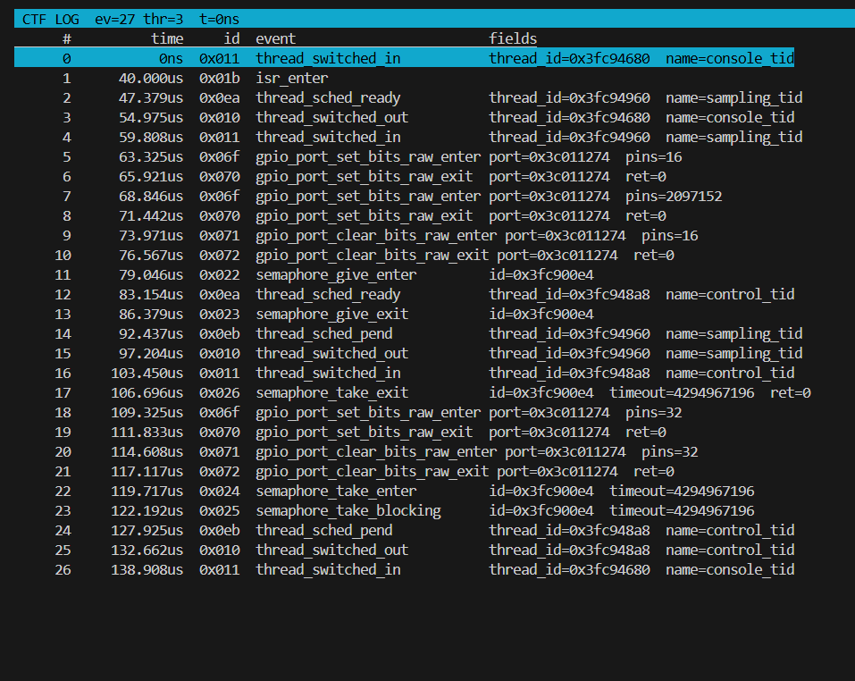
*Fig. 5.6 — Log de eventos de esa misma ventana, con tiempos (E4).*

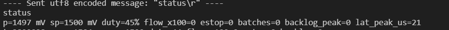
*Fig. 5.7 — `status` del build trazado tras `calib`: `lat_peak_us=21` (E5).*

**La cadena, con tiempos medidos desde el `isr_enter`** (t = 10 596.4259 ms de la captura):

| # | Evento | Tiempo desde la ISR | Qué significa |
|---|---|---|---|
| 1 | `isr_enter` | 0 µs | tick de 1 kHz del `k_timer` |
| 2 | `thread_sched_ready(sampling_tid)` | 7.38 µs | el `k_msgq_put` de la ISR pone listo al muestreo |
| 3 | `thread_switched_out(console_tid)` | 14.97 µs | la consola es **desalojada: queda READY, no bloqueada** (estaba en `k_busy_wait`) |
| 4 | `thread_switched_in(sampling_tid)` | 19.81 µs | corre el muestreo |
| 5 | GPIO4 sube (`instr_samp`) | 23.32 µs | inicio visible en el AD2 |
| 6 | GPIO4 baja | 33.97 µs | fin de `task_sampling` |
| 7 | `semaphore_give` → `thread_sched_ready(control_tid)` | 39.05 → 43.15 µs | es el 10.º tick: `k_sem_give` |
| 8 | `thread_sched_pend(sampling_tid)` | 52.44 µs | su `k_msgq_get` bloquea |
| 9 | `thread_switched_out(sampling)` → `thread_switched_in(control_tid)` | 57.20 → 63.45 µs | **la CPU va a control (prioridad 3), no a la consola** |
| 10 | GPIO5 sube (`instr_ctrl`) | 69.33 µs | corre el control |
| 11 | `thread_sched_pend(control_tid)` → `switched_in(console_tid)` | 87.9 → 98.9 µs | control se bloquea en `k_sem_take`; vuelve la consola, que sigue en `calib` |

En un tick normal, la cadena termina en el paso 8: al bloquearse el muestreo, vuelve directamente la consola. La traza también muestra un 10.º tick fuera de `calib` (t = 16.426 ms), con la misma cadena y tiempos casi idénticos: ready +7.54 µs, entra el muestreo +20.22 µs, entra el control +65.05 µs. Ahí el hilo desalojado es `tracing_thread` en vez de `console_tid`.

**¿Por qué solo sobreviven los primeros ≈ 75 ms de `calib`?** El tracer vacía su búfer de 32 KB (`CONFIG_TRACING_BUFFER_SIZE=32768`) desde un hilo de la prioridad más baja. Durante `calib`, `console_tid` (prioridad 9) hace espera activa y nunca se bloquea, así que el tracer no corre. Los 32 KB se llenan en ≈ 70 ms (≈ 456 KiB/s de eventos) y lo demás se descarta hasta que `calib` termina. **Medido: `calib` es visible 70.1 ms de ≈ 400 ms, es decir, 167 de 1000 *busy-waits*.**

**Estadísticas de todos los ticks completos de la captura** (10 327 ticks, 66 dentro de `calib`, 1134 décimos ticks):

| Intervalo | n | Mínimo | Mediana | p99 | Máximo |
|---|---|---|---|---|---|
| ISR del tick → `switched_in(sampling)` | 10 327 | 19.34 µs | 20.19 µs | 31.70 µs | 38.29 µs |
| ISR del tick → GPIO4 sube | 10 327 | 22.89 µs | 23.80 µs | 35.37 µs | 41.94 µs |
| Cambio de contexto: `out(X)` → `in(sampling)` | 10 327 | 4.70 µs | 4.85 µs | 4.93 µs | 5.42 µs |
| 10.º tick: `pend(sampling)` → `in(control)` | 1134 | 10.89 µs | 11.15 µs | 11.36 µs | 11.85 µs |
| 10.º tick: GPIO4 baja → GPIO5 sube (equivale al lab 4) | 1134 | 35.06 µs | 35.96 µs | 36.43 µs | 36.65 µs |
| Ancho de `instr_samp` con traza | 10 326 | 10.44 µs | 10.94 µs | 11.11 µs | 11.55 µs |

**Carga de CPU por hilo.** La captura de `calib` se midió en la ventana de 588.1 a 11 174.3 ms (10.6 s):

| Hilo | CPU % |
|---|---|
| `tracing_thread` | 75.31 |
| `idle` | 8.62 |
| sin identificar (tracer sin su `in`/`out`) | 7.68 |
| `console_tid` (incluye los `calib`) | 4.10 |
| `sampling_tid` | 3.51 |
| `telemetry_tid` | 0.42 |
| `control_tid` | 0.29 |
| `display_tid` | 0.03 |
| nombres corruptos por bytes perdidos | 0.04 |
| **Suma** | **100.00** |

En la captura normal de 3 s (Fig. 5.3): `idle` 9 %, `sampling_tid` 3 %, los demás ≈ 0 %. El resto, ≈ 87 %, es el tracer, que no se traza a sí mismo. **Sin traza, el thread analyzer da `idle` 99.11 %, `console` 0.45 %, `sampling` 0.38 % y `control` 0.05 % (semana 4).** La traza convierte un nodo ocioso al 99 % en uno ocupado al ≈ 90 %.

**Tarea C: el precio de mirar.** Se usó el Scope a 6.67 MHz con *Measurements* sobre `instr_samp`, con la traza encendida (captura de 45 s en curso, 16 627 107 B) y apagada (build plano del lab 4).

| | |
|---|---|
| 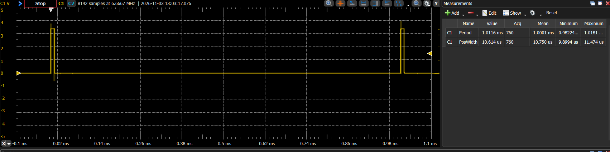 |  |
| *Fig. 5.8 — **Traza encendida**, 760 adquisiciones: periodo 0.98224–1.0181 ms, ancho 10.75 µs (E6).* | *Fig. 5.9 — **Traza apagada**, 996 adquisiciones: periodo 0.99778–1.0020 ms, ancho 0.742 µs (E7).* |


*Fig. 5.10 — Captura de traza que corría durante la Fig. 5.8: 45 s, 361 KiB/s.*

**Tabla de la semana 5:**

| Medida | Predicción | Valor medido | Contraste |
|---|---|---|---|
| Cambio de contexto según la traza | 5 µs | **4.85 µs** mediana, 5.42 µs máximo (`out(X)` → `in(sampling)`); 10.º tick `pend` → `in(control)`: 11.15 / 11.85 µs | vs GPIO (sem. 4): **8.56 µs** sin traza; el mismo hueco GPIO con traza: 35.96 / 36.65 µs |
| ISR del tick → inicio del muestreo según la traza | 10 µs | **20.19 µs** mediana, 38.29 µs máximo (`switched_in`); hasta GPIO4: 23.80 / 41.94 µs | vs `lat_peak_us`: **13 µs** (con traza, reposo), **21 µs** (con traza, tras `calib`), **9 µs** sin traza (sem. 4) |
| Carga de CPU por hilo (%) en operación normal | idle ≈ 99 % | ver tabla de carga (idle 9 % con traza; 99.11 % sin traza) | suma 100 % con idle y el tracer ✔ |
| Overhead del tracing sobre el jitter máximo de muestreo | +10 µs | **+15.9 µs** (18.1 µs con traza vs 2.2 µs sin traza) | AD2 Scope, traza encendida vs apagada |

**Análisis: ¿por qué difieren la traza y el GPIO?** Miden puntos distintos de la misma cadena:

- **Qué marca cada uno.** La traza marca eventos del kernel (`switched_out` / `switched_in` dentro del planificador). El GPIO marca la primera y la última línea del código de la tarea.
- **Por qué el hueco GPIO es mayor.** El hueco GPIO de 8.56 µs incluye lo que rodea al cambio de 4.85 µs: el resto de `k_sem_give`, la entrada a `k_msgq_get` y el retorno de `k_sem_take`.
- **Por qué la traza describe un sistema más lento.** En el build trazado, cada evento cuesta CPU. Cada `gpio_pin_set_dt` genera dos eventos de ≈ 2.5 µs (`gpio_port_set_bits_raw_enter/exit`, Fig. 5.6). Por eso `C_samp` pasa de 0.742 µs a 10.75 µs (× 14.5) y el hueco GPIO de 8.56 µs a 36.65 µs (× 4.3).

**`lat_peak_us` frente a la traza.** `lat_peak_us` empieza en `k_cycle_get_32()` dentro de `tick_isr`, es decir, después del prólogo de la ISR del timer, y termina cuando retorna `k_msgq_get`. La traza empieza antes, en `isr_enter`. Por eso el máximo de la traza (38.29 µs) supera el `lat_peak_us` del mismo build (21 µs): la diferencia, ≈ 17 µs en el peor caso, es el prólogo y el despacho del timer, que el firmware no ve y la traza sí. Sin traza, `lat_peak_us = 9 µs`. REQ-SAMP-02 (≤ 100 µs) se cumple incluso con traza: 41.94 µs hasta GPIO4.

**Lectura del overhead.** El jitter máximo pasa de 2.2 µs a 18.1 µs (+15.9 µs, × 8). Ese delta es carga del observador: eventos escritos en cada cambio de contexto y cada GPIO, y un tracer que ocupa ≈ 75 % de la CPU. Por eso el curso **mide con GPIO y explica con trazas**: ningún número del A/B ni de la §1.2 sale de un build trazado. En la §1.2 cada `C_i` indica su instrumento.

> **¿Y FreeRTOS?** El concepto es el mismo con otras herramientas. Los macros de traza del kernel quedan vacíos hasta que un grabador los llena: Percepio Tracealyzer (comercial) o SEGGER SystemView. En ESP-IDF sobre el S3, `app_trace` envía datos de SystemView por el mismo jack USB. La lección transferible es que todo observador perturba.

---

### 3.6 Matriz de trazabilidad (RTM)

Cada requisito, en dos saltos: requisito → tarea → medición.

| REQ | Tarea | Evidencia (arquitectura actual: kernel) | Estado |
|---|---|---|---|
| REQ-SAMP-01 (jitter ≤ 50 µs) | `sampling_tid` | 2.22 µs en reposo (Fig. 5.9); ≤ 9 µs con `calib` (Fig. 4.2, 4.3). Superloop con `calib`: 412 884 µs (Fig. 2.15) | ✔ kernel · ✘ superloop |
| REQ-SAMP-02 (inicio ≤ 100 µs) | ISR + `sampling_tid` | `lat_peak_us` 9 µs sin traza (Fig. 4.2); 41.94 µs máximo hasta GPIO4 con traza (§3.5) | ✔ |
| REQ-CTRL-01 (cada 10 ms) | `control_tid` | Pulsos continuos durante `calib` (Fig. 4.3); entra ≤ 11.85 µs tras el muestreo en 1134 décimos ticks (§3.5). Superloop e hilo único: ≈ 400 ms (Fig. 3.4, 3.10) | ✔ kernel · ✘ semanas 2–3 |
| REQ-CTRL-02 (válvula ≤ 5 ms) | `sampling_tid` detecta, `control_tid` actúa | Por diseño, la sobrepresión se detecta a 1 kHz pero la válvula solo cambia cuando corre el control: peor caso ≈ 10 ms (est.) | **✘ pendiente (semana 6)** |
| REQ-CONS-01 (eco ≤ 20 ms) | `console_tid` | Sondeo cada 5 ms + 54 µs por carácter (Fig. 3.6) → ≤ 5.1 ms (est.) | ✔ por diseño, sin medición directa |
| REQ-TELE-01 (1 s ± 100 ms) | `telemetry_tid` | Periodo de 999 960.8 µs (Fig. 2.11); sueño absoluto en el kernel (líneas `t=` cada 1000 ms, Anexo B). Superloop con `calib`: 1 081 194 µs (Fig. 2.15) | ✔ |
| REQ-FLOW-01 (≤ 100 ms) | `flow_wq` | Superloop en reposo: 8 µs máximo; con `calib`: 397 952 µs ✘ (Fig. 2.15). Kernel: pulsos de `flow` continuos durante `calib` (Fig. 4.3) | ✔ kernel · ✘ superloop con `calib` |
| REQ-HMI-01 (500 ms) | `display_tid` | Sin pantalla OLED en nuestro montaje | N/A |

---

## 4. Análisis de planificabilidad

**Pendiente: semana 6.** Se hará U = ΣC_i/T_i con los `C_i` medidos sin traza de la §1.2, el test aplicable (RM, hiperbólico o EDF) y el RTA como script, con el bloqueo B_i del mutex.

Datos de partida ya medidos: el thread analyzer da 99.11 % de `idle` bajo carga, así que se espera un U del orden de 1 %.

Desde la semana 12 se agregan el plan de tramas CAN y el presupuesto extremo a extremo:

| Requisito | Nodo `R` (APPCPU) | Salto IPM | CAN `R` | Despertar del Hub (máx.) | Actuación | Suma | Plazo | Medido extremo a extremo |
|---|---|---|---|---|---|---|---|---|
| e-stop → parar bomba | ____ | ____ | ____ | ____ | ____ | ____ | 20 ms | ____ |

## 5. Seguridad funcional (proyecto final)

Pendiente: estado seguro declarado (falla ⇒ válvula cerrada), watchdog y la evidencia de que el fail-safe se dispara.

## 6. Componentes construidos por agente (proyecto final)

Pendiente: GUI y enrutamiento del Hub, construidos por un agente desde `spec/hub-soft.md`. Se registrarán la herramienta, el modelo y dónde vive el log de la sesión.

| REQ | Qué pide la especificación | Cómo se midió | Medido | ¿Cumple? |
|---|---|---|---|---|
| REQ-HUB-xx | … | … | ____ | ____ |

---

## Anexos

### Anexo A — Archivos de este repositorio

| Archivo | Qué es |
|---|---|
| [`scripts/ciclo.py`](scripts/ciclo.py) | Cronómetro del ciclo editar → mensaje (semana 1) |
| [`scripts/analizar_lab02.py`](scripts/analizar_lab02.py) | Análisis de un CSV del Logic del AD2: anchos, periodos, jitter y latencia del flujo (semanas 2–3) |
| `scripts/analizar_traza.py` | Análisis de la traza CTF: cadena de preempción, estadísticas y carga por hilo (semana 5) |
| [`firmware/esp32s3_devkitc_esp32s3_procpu.overlay`](firmware/esp32s3_devkitc_esp32s3_procpu.overlay) | El port al S3 (semana 3) |

### Anexo B — Transcripción de consola, semana 4 (E1)

```text
SoilSense Control — kernel build (esp32s3_devkitc)
type 'help'
t=0 p_mv=0 sp_mv=1500 duty=0 flow_x100=0 estop=0 backlog=0
t=1000 p_mv=1502 sp_mv=1500 duty=46 flow_x100=0 estop=0 backlog=0
t=2000 p_mv=1500 sp_mv=1500 duty=47 flow_x100=0 estop=0 backlog=0
help
commands: help status joy set <mv> clear calib threads
t=3000 p_mv=1509 sp_mv=1500 duty=46 flow_x100=0 estop=0 backlog=0
...
t=9000 p_mv=1486 sp_mv=1500 duty=47 flow_x100=0 estop=0 backlog=0
status
p=1502 mV sp=1500 mV duty=47% flow_x100=0 estop=0 batches=0 backlog_peak=0 lat_peak_us=6
...
set 2000
setpoint = 2000 mV
t=19000 p_mv=2002 sp_mv=2000 duty=62 flow_x100=0 estop=0 backlog=0
t=20000 p_mv=2014 sp_mv=2000 duty=59 flow_x100=0 estop=0 backlog=0
status
p=2000 mV sp=2000 mV duty=60% flow_x100=0 estop=0 batches=0 backlog_peak=0 lat_peak_us=6
...
set 1500
setpoint = 1500 mV
t=27000 p_mv=1499 sp_mv=1500 duty=44 flow_x100=0 estop=0 backlog=0
t=28000 p_mv=1499 sp_mv=1500 duty=46 flow_x100=0 estop=0 backlog=0
t=29000 p_mv=1493 sp_mv=1500 duty=47 flow_x100=0 estop=0 backlog=0
```

Bajo carga (E6): tras `calib` siguen `backlog=0`, `set 2500` → `p_mv=2494` en 1 s y `set 1500` → `p_mv=1499`.

### Anexo C — Thread analyzer, semana 4 (E6)

```text
threads
Thread analyze:
 flow_wq        : STACK: unused 720 usage 304 / 1024 (29 %); CPU: 0 %
                : Total CPU cycles used: 15521020
 telemetry_tid  : STACK: unused 1280 usage 768 / 2048 (37 %); CPU: 0 %
                : Total CPU cycles used: 35341273
 sampling_tid   : STACK: unused 1232 usage 304 / 1536 (19 %); CPU: 0 %
                : Total CPU cycles used: 1884976772
 display_tid    : STACK: unused 1760 usage 288 / 2048 (14 %); CPU: 0 %
                : Total CPU cycles used: 31354015
 control_tid    : STACK: unused 736 usage 288 / 1024 (28 %); CPU: 0 %
                : Total CPU cycles used: 232405514
 console_tid    : STACK: unused 1056 usage 992 / 2048 (48 %); CPU: 0 %
                : Total CPU cycles used: 2221856947
 sysworkq       : STACK: unused 208 usage 304 / 512 (59 %); CPU: 0 %
                : Total CPU cycles used: 968
 idle           : STACK: unused 48 usage 208 / 256 (81 %); CPU: 99 %
                : Total CPU cycles used: 493052241080
 ISR0           : STACK: unused 48 usage 464 / 512 (90 %); CPU: 0 %
                : Total CPU cycles used: 0
```

### Anexo D — Pendientes de medición

1. **Línea base del superloop con el Scope.** Repetirla (CH1 `samp`, Period con estadísticas, ≥ 30 s) para reemplazar la cota de ≈ 70 µs (est.) de las semanas 2 y 3.
2. **Periodo máximo de control en el kernel con `calib`.** Medirlo con el Scope (CH2, Period máximo).
3. **REQ-CTRL-02.** Medir la latencia de sobrepresión → válvula y rediseñar para cumplir 5 ms (semana 6).
